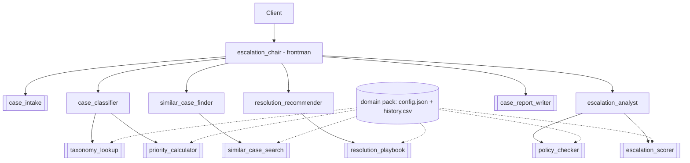

# EscalateIQ: a universal escalation-decision engine

*The Smart Complaint Resolution Agent, generalized to any project.*
Built on [Neuro SAN](https://github.com/cognizant-ai-lab/neuro-san) for the NeuroSAN Track 2 hackathon.
All data is synthetic. One LLM API key. No external systems.

## The idea, refactored

Every organization keeps asking the same question about very different things: **should this case be escalated,
to whom, how fast, and why?** A customer complaint, a production incident, a late vendor, an HR case and a
regulatory query all follow the same logic: classify, look at history, pick a resolution, check policy, decide.
Only the vocabulary, the SLAs, the rules and the history differ.

So the engine is generic and the domain is data. A **domain pack** is a folder with a `config.json` (taxonomy,
SLAs, escalation rules, resolution playbook) and a `history.csv` (past cases). The agent network never changes.

| Domain pack shipped | Example case | Typical route |
| --- | --- | --- |
| `customer_complaints` | Mobile banking login failing after an update | Problem Management, Fraud Unit, Compliance |
| `it_incidents` | Checkout API timing out after a deployment | Incident Commander, SOC, Problem Management |
| `project_delivery` | Vendor missed the payments API date | PMO Risk Board, Portfolio Director, Delivery Director |

Adding a fourth domain (HR cases, vendor disputes, compliance breaches...) takes one folder and no code.
See [DOMAIN_PACK_GUIDE.md](DOMAIN_PACK_GUIDE.md).

## Why it is valuable

- **Under-escalation** hides risks until they are expensive. **Over-escalation** buries specialists.
  EscalateIQ makes the call consistently and shows its work.
- **Explainable:** every decision is a named, signed list of factors, plus the *pivotal factors* that would flip it.
- **Systemic pattern detection:** several similar recent cases trigger a Problem Management escalation even when
  each individual case looks routine.
- **Policy as data:** mandatory rules (legal threat, security risk, fraud above a limit) force escalation and
  are editable without code.
- **Auditable:** every decision appends a record to `escalation_audit.jsonl` and writes a full evidence report.
- **What-if:** change one fact and get a computed "what changed" comparison.

## Architecture



Rounded `[[ ]]` boxes are deterministic Python coded tools; the others are LLM agents.

| Agent | Role | Tools |
| --- | --- | --- |
| escalation_chair (frontman) | Runs the review, chooses the domain, writes the report | case_intake, case_report_writer |
| case_classifier | Category, severity, business area, priority | taxonomy_lookup, priority_calculator |
| similar_case_finder | Historical cases, what worked, recurrence | similar_case_search |
| resolution_recommender | Best resolution, justification, next steps | resolution_playbook |
| escalation_analyst | Policy check, decision, target, SBAR handoff | policy_checker, escalation_scorer |

The shared `sly_data` dictionary is a bulletin board: tools publish their results there, so numbers reach the
scorer and the report without passing through any LLM's chat stream.

## How the decision is made

```text
score = priority + SLA burn + prior contacts + recurrence + value at risk + frustration
        + policy rules (scaled, capped) +/- resolution track record +/- authority limit
decision = URGENT_ESCALATION  if score >= 80, or a mandatory rule fires on a P1
           ESCALATE           if score >= 50, or any mandatory rule fires
           RESOLVE_AT_L1_WITH_MONITORING if score >= 30
           RESOLVE_AT_L1      otherwise
```

Thresholds, points and rules live in each pack, so every domain can be tuned. Confidence is High, Medium or Low
from data completeness, number of similar cases and distance to the nearest threshold.

## Mapping to the original brief

| Original brief | Here |
| --- | --- |
| Complaint Categorizer | `case_classifier` + `taxonomy_lookup` + `priority_calculator` |
| Similar Case Finder | `similar_case_finder` + `similar_case_search` (TF-IDF, no vector DB install) |
| Resolution Recommender | `resolution_recommender` + `resolution_playbook` |
| Escalation Agent | `escalation_analyst` + `policy_checker` + `escalation_scorer` |
| Resolution summary report | `case_report_writer` (markdown + audit log) |
| CrewAI or AutoGen | Neuro SAN, as required by the hackathon |
| FAISS / Chroma | Pure-Python TF-IDF so the demo needs no extra installs (swap-in point: `text_similarity.py`) |
| SQL / CSV history | CSV per domain pack |
| Streamlit dashboard | Not built; the agent chat client and the saved report are the demo surface |

## Repository layout

```text
neuro_san/registries/escalation_iq.hocon               # the agent network
neuro_san/registries/manifest.hocon                    # manifest with the new entries
neuro_san/coded_tools/escalation_iq/*.py               # 8 coded tools + 5 helpers
neuro_san/coded_tools/escalation_iq/domain_packs/      # one folder per domain
scripts/smoke_test_escalation_iq.py                    # runs every tool with no LLM
docs/escalation_iq/                                    # this documentation
reports/                                               # generated reports and the audit log (git-ignored)
```

## Honest limitations

- All history, rules and thresholds are **synthetic**, tuned for the demo, and are not real policy.
- Similarity is lexical (TF-IDF), not semantic embeddings. It works well on the shipped data; for production use
  swap in an embedding index behind the same interface.
- The history's latest date is used as "today" for recurrence, so the synthetic clusters stay detectable.
- LLM agents vary run to run. The priority, score, similarity and policy results do not, because tools compute them.
